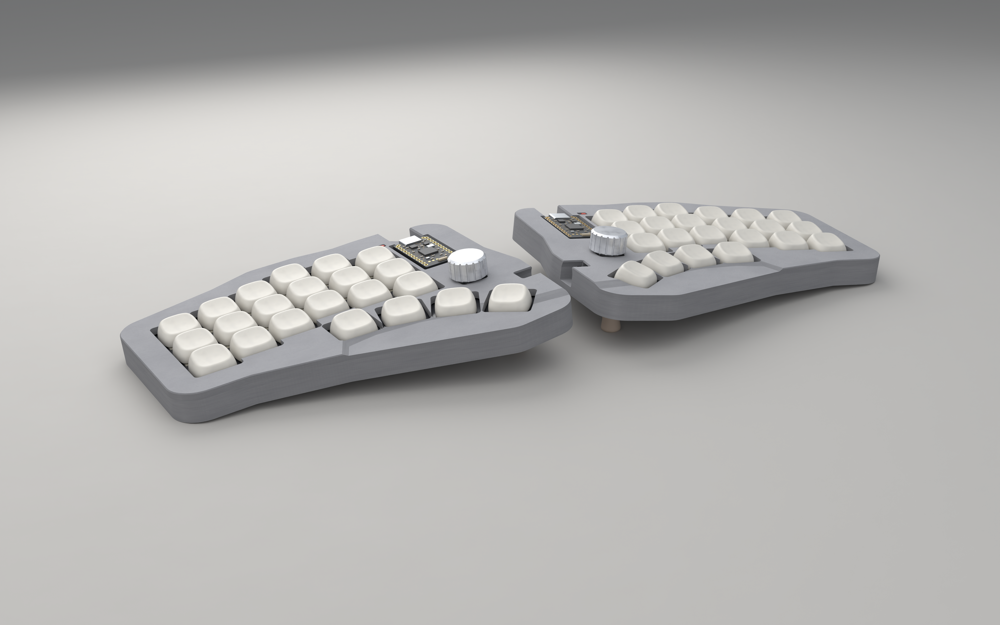
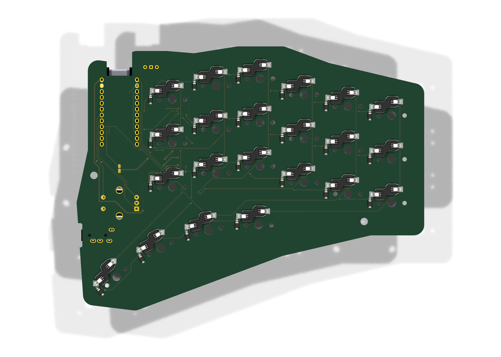

# Hojicha44

A low-profile wireless split keyboard with 44 keys, two knobs, and a gasket-mounted plate.

Set each half where your hands naturally land. The staggered columns follow your fingers, and four keys along each thumb’s arc put everyday controls within reach. Turn either knob for volume, scrolling, or track control, depending on the active layer. Push either one to mute.

[Find the v0.5.4 build files](pcb/MANUFACTURING.md) · [See the keymap](spec/keymap.md) · [Explore the v0.5.4 assembly](generated/renders/v0.5.4/bright/exploded.png) · [See all v0.5.4 renders](generated/renders/v0.5.4/README.md)

## What’s inside

- **Low-profile Choc v1 switches.** Hotswap sockets let you change the switches without soldering.
- **A floating polycarbonate plate.** PORON pads cradle the switch plate, and magnets hold each removable cover in place.
- **A wireless split.** Two nice!nano v2 controllers run ZMK and link the halves over Bluetooth. Connect to your computer over Bluetooth or plug into the left half for USB.
- **Familiar QWERTY with thumb layers.** Tap home-row keys for letters and hold them for modifiers. The thumb layers bring numbers, symbols, function keys, and navigation into reach. Choose a macOS or Windows/Linux keymap and put Space under either thumb.

## Build one

**v0.5.4 is the engineering sample.** Use the matching PCB, plate and case files from this tree. The diodes sit on the underside, so the switch plate can be through-cut from flat polycarbonate. The published v0.5.2 case can obstruct larger USB-C plugs at the low end of the socket stack. Build one pair and work through the first-article checks before ordering a batch. The PCB has a routed relief behind each debug jack so the plug boot can seat.

[Parts list](spec/bom.md) · [Fabrication guide](pcb/MANUFACTURING.md) · [First-article checklist](spec/first-article.md)

### v0.5.4 PCB, underside

[Left top](generated/renders/v0.5.4/pcb/Hojicha44-Left-top.png) · [Left bottom](generated/renders/v0.5.4/pcb/Hojicha44-Left-bottom.png) · [Right top](generated/renders/v0.5.4/pcb/Hojicha44-Right-top.png) · [Right bottom](generated/renders/v0.5.4/pcb/Hojicha44-Right-bottom.png)

The design files are available for anyone who wants to inspect or adapt the board. [KiCad projects](pcb/kicad/) · [Ergogen layout](layout/ergogen/config.yaml) · [Case design](case/)
